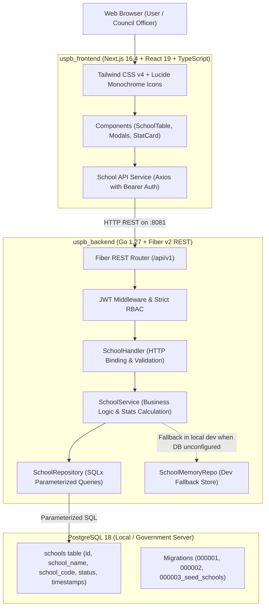

# Urban Services Portal Balangoda (USPB)
## School Waste Rewards Management — Current Version & Functions Guide

---

## 1. Executive Summary: What is this Version About?

This current version on branch `feat/praneepa-school-rewards` represents the audited, robust, and production-ready **School Management** feature, which serves as the foundational core of the **School Waste Rewards Management** module for the **Balangoda Urban Council (BUC)** in Sri Lanka.

The municipal portal allows authorized council personnel (e.g., **Eco-Rewards Coordinators**, **Garbage Supervisors**, and **System Administrators**) to onboard local schools into the municipal waste segregation reward initiative, maintain accurate institutional records, track participation status, inspect school profiles, and monitor council-wide participation metrics.

---

## 2. Core Functional Capabilities

```
+-----------------------------------------------------------------------------------------+
|                  Balangoda Urban Council - School Rewards Management                     |
+-----------------------------------------------------------------------------------------+
|                                                                                         |
|  [ Stat Cards - Global Municipal Metrics (Independent of Active Table Filters) ]        |
|  * Total Registered Schools: 5              * Active Schools: 3                         |
|  * Inactive Schools: 2                      * Program Coverage: 60.0%                   |
|                                                                                         |
|  [ Action Bar ]                                                                         |
|  [ Search by name, code or address... (X) ]  [ Status: All / Active / Inactive ]         |
|  [ + Register New School Button ]                                                       |
|                                                                                         |
|  [ Active Filters: Query: "ananda" (1 result found) | Reset all filters ]               |
|                                                                                         |
|  [ Schools Data Table with Column Sorting ]                                             |
|  -------------------------------------------------------------------------------------  |
|  School Code ^ | Institution Name ^ | Postal Address | Contact | Status ^ | Actions     |
|  -------------------------------------------------------------------------------------  |
|  BAMCC-001     | Balangoda Ananda.. | Barnes Rat...  | 045-..  | [ACTIVE] | [O] [/] [||]|
|  SACB-002      | St. Agnes Convent  | Convent Rd     | 045-..  | [ACTIVE] | [O] [/] [||]|
|  MMV-003       | Meddakanda M.V.    | Meddakanda     | 045-..  | [ACTIVE] | [O] [/] [||]|
|  JNC-004       | Jeilani Nat. Coll. | Colombo Rd     | 045-..  | [INACT.] | [O] [/] [>] |
|  BBLC-005      | Balangoda Buddhist | Station Rd     | 045-..  | [INACT.] | [O] [/] [>] |
+-----------------------------------------------------------------------------------------+
```

### Feature 1: Global Municipal Statistics & Program Coverage
- **Dedicated Global Metrics Endpoint**: `GET /api/v1/schools/stats` aggregates counts across the entire registry, completely separate from active table filters or pagination.
- **Independent KPI Cards**: Searching for a school or filtering by status in the data table **never** distorts the council's global statistics.
- **Dynamic Program Coverage Calculation**:
  $$\text{Program Coverage} = \left(\frac{\text{Active Schools}}{\text{Total Registered Schools}}\right) \times 100$$
  *(e.g., 3 active out of 5 registered = 60.0%; if 0 schools are registered, safely displays 0%)*.
- **Standardized Council Nomenclature**:
  - `Total Registered Schools`
  - `Active Schools`
  - `Inactive Schools`
  - `Program Coverage`

### Feature 2: School Listing, Sorting & Search Feedback
- **Live Parameterized Search**: Real-time querying across school name, unique school code, postal address, and contact number.
- **Search Feedback Bar**: Clear visual badge showing active query and count of matching records (e.g., *"Query: 'ananda' (1 result found)"*) with an instant clear button (`X`).
- **Interactive Column Sorting**: Clickable column headers on `School Code`, `Institution Name`, and `Status` toggling ascending (`▲`), descending (`▼`), or default order.
- **Two-Tier Empty States**:
  - *Filtered empty state*: Displays *"No Matching Schools Found"* with a one-click *"Reset Search & Filters"* button.
  - *Clean initial state*: Displays *"No Schools Registered Yet"* with a *"Register New School"* call to action.
- **Accessible Action Controls**: Every icon action button features explicit `title` tooltips and descriptive `aria-label` attributes (`"View details for..."`, `"Edit..."`, `"Deactivate..."`).

### Feature 3: School Registration (Add School)
- **Modal Form Interface**: Controlled dialog for registering new institutions.
- **Two-Tier Validation**:
  - *Client-side*: Real-time validation for non-empty name (2-255 chars), valid alphanumeric/hyphen code (2-50 chars), and phone number format.
  - *Server-side*: Validates payload structure, sanitizes whitespace, and checks regex constraints.
- **Code Collision Prevention**: Database-level `UNIQUE` constraint on `school_code`, returning HTTP `409 Conflict` if duplicate code is submitted.

### Feature 4: School Information Editing
- **Non-Destructive Updates**: Edit modal pre-populates existing record and updates name, address, contact, and code without modifying audit histories or unrelated records.
- **Code Uniqueness Verification**: Prevents updating a code to conflict with an existing institution.

### Feature 5: School Details & Audit Inspection
- **Institutional Profile Modal**: Modal inspecting official address, telephone number, registration timestamp (`created_at`), and last update timestamp (`updated_at`).
- **Phase 2 Student Statistics Placeholder**: Displays an informative notice explaining that student roster and individual badge tracking will automatically populate in Phase 2, avoiding fabricated numbers.

### Feature 6: Activation & Deactivation (Status Management)
- **Quick Status Toggle**: Single-click activation or deactivation directly from the table row.
- **Confirmation Safety Dialog**: Reversible modal requiring explicit confirmation before updating operational status.
- **Historical Data Protection**: Prevents permanent hard deletion if a school has associated students, collection records, or financial history (`409 Conflict`). Deletions are strictly restricted to the `ADMIN` role.

---

## 3. Technology Stack & Architectural Overview



---

## 4. Backend REST API Endpoints Reference

All endpoints are hosted on port `8081` under the `/api/v1` namespace:

| Method | Route | Description | Auth Required | Authorized Roles | Status Codes |
|:---|:---|:---|:---:|:---|:---:|
| `GET` | `/api/v1/health` | Healthcheck and service uptime probe | No | Public | `200` |
| `GET` | `/api/v1/auth/demo-token` | Generates a signed JWT session *(disabled in production)* | No | Public *(Dev only)* | `200`, `403` |
| `POST` | `/api/v1/auth/login` | Authenticates council user with username & password | No | Public | `200`, `400`, `401` |
| `GET` | `/api/v1/schools/stats` | Global council metrics (`total`, `active`, `inactive`, `coverage`) | **Yes** (JWT) | `ADMIN`, `GARBAGE_SUPERVISOR` | `200`, `401` |
| `GET` | `/api/v1/schools` | Lists schools with search, status filters, and pagination | **Yes** (JWT) | `ADMIN`, `GARBAGE_SUPERVISOR` | `200`, `401` |
| `POST` | `/api/v1/schools` | Registers a new school with unique code validation | **Yes** (JWT) | `ADMIN`, `GARBAGE_SUPERVISOR` | `201`, `400`, `409` |
| `GET` | `/api/v1/schools/:id` | Fetches a single school by ID | **Yes** (JWT) | `ADMIN`, `GARBAGE_SUPERVISOR` | `200`, `404` |
| `PUT` | `/api/v1/schools/:id` | Updates school details | **Yes** (JWT) | `ADMIN`, `GARBAGE_SUPERVISOR` | `200`, `400`, `404`, `409` |
| `PATCH` | `/api/v1/schools/:id/status`| Toggles school status (`active` / `inactive`) | **Yes** (JWT) | `ADMIN`, `GARBAGE_SUPERVISOR` | `200`, `400`, `404` |
| `DELETE`| `/api/v1/schools/:id` | Soft-deletes or blocks if records exist | **Yes** (JWT) | **`ADMIN` strictly** | `200`, `403`, `409` |

---

## 5. Security & Database Reliability Enhancements

1. **Production Guard on Demo Tokens**:
   - `GET /api/v1/auth/demo-token` checks `APP_ENV`. In `production` or `prod`, it returns `403 Forbidden` unless explicitly permitted with `ENABLE_DEMO_AUTH=true`.
2. **Strict RBAC for Deletions**:
   - `DELETE /schools/:id` requires the `ADMIN` role. Supervisors attempting deletion receive `403 Forbidden`.
3. **Database Failure Handling**:
   - In production (`APP_ENV=production`), PostgreSQL connection failure aborts server boot with `log.Fatalf` to prevent data loss.
   - In local development without configured DB credentials, the system logs clear warnings and boots with the in-memory fallback.
4. **Data Consistency**:
   - Migration `000003_seed_schools.up.sql` seeds PostgreSQL with the exact same 5 Balangoda central institutions that populate the in-memory store.

---

## 6. Official Seeded Balangoda Schools

| ID | School Code | Institution Name | Status | Telephone | Official Address |
|:---:|:---|:---|:---:|:---|:---|
| 1 | `BAMCC-001` | Balangoda Ananda Maithreya Central College | `active` | 045-2287234 | Barnes Ratwatte Mawatha, Balangoda |
| 2 | `SACB-002` | St. Agnes Convent Balangoda | `active` | 045-2287512 | Convent Road, Balangoda |
| 3 | `MMV-003` | Meddakanda Maha Vidyalaya | `active` | 045-2288110 | Meddakanda, Balangoda |
| 4 | `JNC-004` | Jeilani National College | `inactive` | 045-2289400 | Colombo Road, Balangoda |
| 5 | `BBLC-005` | Balangoda Buddhist Ladies College | `inactive` | 045-2289890 | Station Road, Balangoda |

---

## 7. Key File Map

### Frontend (`uspb_frontend/`)
- [page.tsx](file:///e:/Dev/Urban-Services-Portal-Balangoda-USPB-/uspb_frontend/src/app/(dashboard)/schools/page.tsx): Main dashboard, coordinates global stats with `fetchStats()`, handles modals and filters.
- [SchoolTable.tsx](file:///e:/Dev/Urban-Services-Portal-Balangoda-USPB-/uspb_frontend/src/components/schools/SchoolTable.tsx): Table with column sorting, search feedback bar, clear buttons, and accessible actions.
- [SchoolFormModal.tsx](file:///e:/Dev/Urban-Services-Portal-Balangoda-USPB-/uspb_frontend/src/components/schools/SchoolFormModal.tsx): Add / Edit modal dialog with real-time field validation.
- [SchoolDetailsModal.tsx](file:///e:/Dev/Urban-Services-Portal-Balangoda-USPB-/uspb_frontend/src/components/schools/SchoolDetailsModal.tsx): View school profile modal with audit timestamps and Phase 2 student stats note.
- [StatusConfirmModal.tsx](file:///e:/Dev/Urban-Services-Portal-Balangoda-USPB-/uspb_frontend/src/components/schools/StatusConfirmModal.tsx): Status change confirmation dialog.
- [StatCard.tsx](file:///e:/Dev/Urban-Services-Portal-Balangoda-USPB-/uspb_frontend/src/components/shared/StatCard.tsx): Uniform metric cards with soft styling and Lucide icons.
- [schoolService.ts](file:///e:/Dev/Urban-Services-Portal-Balangoda-USPB-/uspb_frontend/src/services/schoolService.ts): Axios service client including `getSchoolStats()`.
- [index.ts (types)](file:///e:/Dev/Urban-Services-Portal-Balangoda-USPB-/uspb_frontend/src/types/index.ts): TypeScript interfaces for `School`, `SchoolStats`, `SchoolListResult`, etc.

### Backend (`uspb_backend/`)
- [main.go](file:///e:/Dev/Urban-Services-Portal-Balangoda-USPB-/uspb_backend/cmd/server/main.go): Server entry point, database connection fail-fast logic, router wiring.
- [school_model.go](file:///e:/Dev/Urban-Services-Portal-Balangoda-USPB-/uspb_backend/internal/modules/schoolrewards/school_model.go): Data domain structs and `SchoolStats`.
- [school_handler.go](file:///e:/Dev/Urban-Services-Portal-Balangoda-USPB-/uspb_backend/internal/modules/schoolrewards/school_handler.go): Fiber handlers for schools and `GetStats`.
- [school_service.go](file:///e:/Dev/Urban-Services-Portal-Balangoda-USPB-/uspb_backend/internal/modules/schoolrewards/school_service.go): Business logic, uniqueness checks, stats calculation.
- [school_repository.go](file:///e:/Dev/Urban-Services-Portal-Balangoda-USPB-/uspb_backend/internal/modules/schoolrewards/school_repository.go): SQLx queries including `GetStats()` SQL aggregation.
- [school_memory_repo.go](file:///e:/Dev/Urban-Services-Portal-Balangoda-USPB-/uspb_backend/internal/modules/schoolrewards/school_memory_repo.go): In-memory store with `GetStats()` and 5 authentic Balangoda seeds.
- [school_test.go](file:///e:/Dev/Urban-Services-Portal-Balangoda-USPB-/uspb_backend/internal/modules/schoolrewards/school_test.go): 10 unit and integration tests verifying creation, validation, duplicate prevention, stats calculation, and RBAC.
- [000003_seed_schools.up.sql](file:///e:/Dev/Urban-Services-Portal-Balangoda-USPB-/uspb_backend/migrations/000003_seed_schools.up.sql): Migration seeding schools into PostgreSQL.
