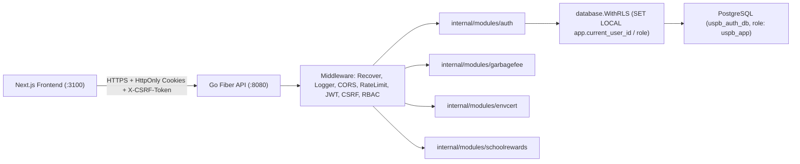
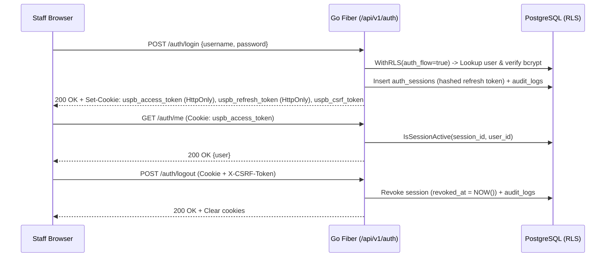

# Architecture & Security Design

## 1. Modular Monolith Architecture

---

## 2. Authentication & Session Lifecycle

---

## 3. Role-Based Access Control (RBAC) & School Isolation

| Role | Default Dashboard | Permitted Modules | Scope Constraint |
| :--- | :--- | :--- | :--- |
| `ADMIN` | `/admin` | Auth Admin (`/admin/users`, `/admin/audit-logs`), read summaries | System-wide |
| `FEE_OFFICER` | `/garbage-fees` | Garbage Fee Management | Module-wide |
| `ENV_OFFICER` | `/environmental` | Environmental Certificates | Module-wide |
| `GARBAGE_SUPERVISOR` | `/schools` | School Waste Rewards (council-wide, rates, reports) | All schools |
| `TEACHER` | `/schools` | School Waste Rewards (students, collections, payouts) | **Single assigned `school_id` only** |

---

## 4. Key Security Controls
1. **Least-Privilege Database Role**: Application connects as `uspb_app` (`NOSUPERUSER`, `NOCREATEDB`, `NOCREATEROLE`, `NOBYPASSRLS`) to isolated database `uspb_auth_db`.
2. **PostgreSQL Row-Level Security (RLS)**: `FORCE ROW LEVEL SECURITY` enabled on `users`, `auth_sessions`, and `audit_logs`. Every repository call runs inside `database.WithRLS` which sets transaction-local `app.current_user_id`, `app.current_role`, and `app.auth_flow`.
3. **No `localStorage` Tokens**: Access and refresh tokens are stored strictly in `HttpOnly` cookies; state-changing requests require a matching `X-CSRF-Token` header (double-submit cookie).
4. **Refresh Token Rotation & Reuse Detection**: Each `/auth/refresh` rotates the opaque refresh token hash. Presenting a previously revoked refresh token revokes **all** active sessions for that user.
5. **Brute-Force Protection**: IP-based rate limiting on `/auth/login` plus per-account lockout (`failed_login_attempts`, `locked_until`).
6. **Fail-Fast Config**: `config.Load()` rejects missing or short (`< 32` chars) `JWT_SECRET` at startup.
